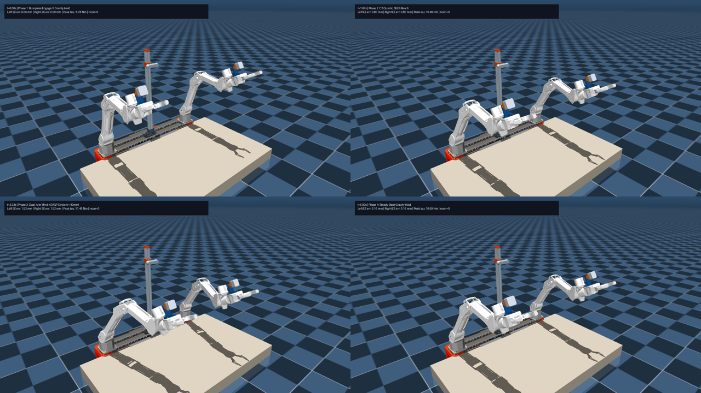

# Firefly Dual-Arm MuJoCo Simulation & Constrained Mink IK

Clean MuJoCo 3.x (`MjSpec`) simulation, constrained differential IK (`mink` + `daqp`), and **Bumpless Transfer + Gravity-Compensated (G + PID + Anti-Windup)** control for the `firefly_dual` dual-arm robot.



## Project Structure

- `assets/firefly_dual.urdf` & `assets/meshes/` — Source URDF and STL/OBJ meshes.
- `model/firefly_dual.xml` & `model/scene.xml` — Normalized MuJoCo MJCF asset and tabletop scene.
- `src/build_mjcf.py` — Converts `firefly_dual.urdf` into normalized MJCF via `mujoco.MjSpec` (visual group 2 / collision group 3 separation, adjacent-link `<exclude>`, `implicitfast` 500 Hz, calibrated `armature`/`damping`/`frictionloss`, torque `<motor>` actuators, `125 mm` EE sites, `170 mm` TCP sites, and calibrated optical cameras).
- `src/ik_solver.py` — `FireflyDualIK`: Mink + DAQP constrained differential IK using the exact `MjModel` (eliminating URDF-vs-IK kinematic mismatch), enforcing `ConfigurationLimit` and URDF `VelocityLimit`, with `reset_to_measured(q_meas)` for bumpless initialization and $C^2$ quintic $SE(3)$ blending.
- `src/controller.py` — `BumplessGravityController`:
  - **Gravity Compensation**: Computes $\tau_g(q_{\text{meas}})$ from a dedicated dynamics twin (`MjModel`/`MjData` using only encoder `q_meas`).
  - **Steady-State Error Elimination**: G + PID with back-calculation anti-windup, eliminating sag even under unmodeled payload/friction.
  - **Bumpless Transfer**: `PASSIVE -> ENGAGING -> ACTIVE` state machine that latches `q_meas`, pre-loads integrator state to match $\tau_{\text{prev}}$, and ramps authority with a $C^2$ quintic blend.
- `src/sim_runner.py` & `src/render_demo.py` — Closed-loop headless/interactive simulation and 720p MP4 renderer (`docs/media/firefly_sim_demo.mp4`).
- `tests/verify_sim_ik.py` & `tests/eval_regression_25.py` — Verification suite and 25-case regression benchmark (`ik_regression_25/`).
- `CHANGELOG.md` — Project changelog, verified metrics, and open engineering gaps.

## Quick Start

```bash
# 1. Rebuild MJCF from URDF
/home/lakeside/.venvs/mujoco/bin/python src/build_mjcf.py

# 2. Run quantitative verification suite
/home/lakeside/.venvs/mujoco/bin/python tests/verify_sim_ik.py

# 3. Run 25-case regression benchmark
/home/lakeside/.venvs/mujoco/bin/python tests/eval_regression_25.py

# 4. Run closed-loop demo & render video
/home/lakeside/.venvs/mujoco/bin/python src/sim_runner.py
MUJOCO_GL=egl /home/lakeside/.venvs/mujoco/bin/python src/render_demo.py
```
