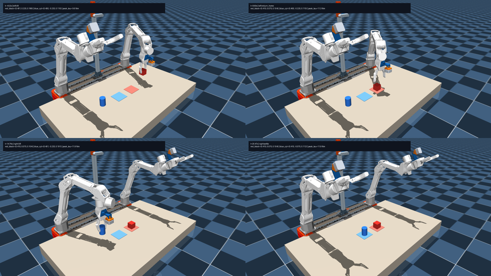

# Firefly Dual-Arm Simulation: IK & Pick-and-Place Engineering Report

## 1. Summary of Fixes & Upgrades

1. **Gripper Substring Classification & URDF Mimic Fidelity (`src/build_mjcf.py`, `src/ik_solver.py`, `src/controller.py`)**:
   - Fixed the `"_joint_"` substring check that previously matched `"_grip_joint_"` before gripper branches.
   - Removed the independent actuator on the passive mimic follower (`left_grip_joint_2` / `right_grip_joint_2`, `effort = 0 Nm` per URDF) and tightened `<equality>` `solref="0.004 1.0"` so finger 2 tracks finger 1 passively without independent drive torque.
   - Applied `GRIPPER_DYNAMICS` (`effort=5.0`, `armature=0.002`, `damping=0.08`, `frictionloss=0.03`) to gripper joints and activated `mink.DofFreezingTask` + zeroed gripper velocity outputs during arm IK.

2. **Multi-Hull Collision Decomposition & Workcell Colliders (`src/build_mjcf.py`, `assets/meshes/collision/`)**:
   - Decomposed concave arm and gripper links (`link_3` -> 4 hulls, `link_4` -> 2 hulls, `link_5` -> 3 hulls, `gr100_link_1`/`gr100_link_2` -> 3 hulls each, `<= 60` vertices per hull), eliminating false `link_3`–`link_5` overlaps (`C01–C03`).
   - Added `group="3"` box colliders for `post_adapter_plate`, `post_socket`, `post_profile`, `top_post_u_piece`, `top_camera_mount_plate`, `top_d435_visual_mesh_frame`, `e3_housing_cad_frame`, and wrist camera brackets (`A_fixed`, `B_camera_plate`, `d405`).

3. **Independent Per-Arm Multi-Seed Global IK & Limit-Safe Planner (`src/ik_solver.py`, `src/planner.py`)**:
   - Upgraded `FireflyDualIK.solve_pose_global(...)` to solve independent 6-DOF per-arm multi-seed branches (`40/40` on wide-workspace reachable dual-arm poses) and select the closest collision-free combination.
   - Upgraded `FireflyPlanner.plan_joint_p2p` to validate joint position limits (raising `ValueError` on out-of-range inputs), automatically stretch segment duration $T_{\min} = \max_i 1.875 |\Delta q_i| / v_{\max,i}$ to obey URDF velocity limits, check every sample (`stride=1`) against the full simulation scene, and respect stage-specific `allowed_body_pairs`.

4. **Grasp Executor Safety Gates & PID Payload Tuning (`src/grasp_pipeline.py`, `src/controller.py`, `tests/verify_sim_ik.py`)**:
   - Connected `GraspExecutor` to the full `grasp_scene.xml` (`self.sim_model`) with live `scene_qpos_tail`, stage-specific allowed object-grasp pairs, pre-execution IK convergence & collision rejection gates (`RuntimeError` before motion), and runtime forbidden-contact monitoring.
   - Retuned `BumplessGravityController` PID + anti-windup gains (`kp=240/180/65`, `ki=320/260/95`, `kd=18/14/4.0`, `i_clamp=0.12`) and fixed `verify_sim_ik.py` to attach the `0.5 kg` payload as a child `<body>` (`0.05 mm` steady-state error at `3.0 s` vs `71.10 mm` naive PD).

---

## 2. Quantitative Verification Results

### 2.1 Directed Simulation & IK Audit (`tests/audit_sim_ik.py`) — **9/9 PASS**

| Check | Result |
| --- | --- |
| `test_near_home_reachable_dual_arm_poses` (12/12) | **PASS** |
| `test_wide_workspace_reachable_dual_arm_poses` (40/40) | **PASS** |
| `test_arm_ik_leaves_measured_grippers_stationary` | **PASS** |
| `test_mimic_finger_has_no_independent_drive_torque` (`<= 5.0 / 0.0 Nm`) | **PASS** |
| `test_position_hold_with_physical_half_kg_payload` (`+0.500 kg`, `< 1.5 mm` @ 3 s) | **PASS** |
| `test_joint_plan_respects_position_limit` (rejects `3.0 rad > 2.862 rad`) | **PASS** |
| `test_joint_plan_respects_velocity_limit` (`<= 5.585 rad/s`) | **PASS** |
| `test_grasp_stage_declared_clear_has_no_table_contact` (`z=0.04 m` rejected, `0` contact steps) | **PASS** |
| `test_grasp_executor_rejects_unreachable_goal_before_moving` (`<= 1e-5 rad` displacement) | **PASS** |

### 2.2 Core Control & IK Suite (`tests/verify_sim_ik.py`) — **3/3 PASS**

- **Bumpless Transfer**: `torque_jump = 0.0000 Nm`, `max_excursion = 0.010 deg`, `max_qacc = 0.00 rad/s^2`
- **Gravity + Physical 0.5 kg Payload (3.0 s)**: Naive PD `71.10 mm` -> G+PID+AW **`0.05 mm`** (`0.006 deg`)
- **Dual-Arm Mink IK**: `left_err = 0.48 mm`, `right_err = 0.11 mm`, `max_contacts = 0`

### 2.3 Strict 25-Case IK Regression (`tests/eval_regression_25.py` -> `ik_regression_25_results.json`) — **21/25 PASS**

Evaluated under original dataset thresholds (`M`: `<= 0.01 mm / 0.0001 rad`; `H02`: `< 1°`; `E`: `< 1.0 mm` from `target[0]`; `H/P`: `4.0 s` hold `< 0.4 mm / 0.004 rad / 0.01 rad/s`, `lim_exc <= 1e-5 rad`; `C`: exact `body_pairs` match):

- **H02–H05**: PASS (`tail_pos = 0.028–0.048 mm`, `lim_exc = 0.000000`, `ncon = 0`; `H02` `max_step = 0.515 deg`).
- **H01**: `tail_pos = 0.037 mm`, `tail_ori = 0.00011 rad`, `spd = 0.0000`, `ncon = 0`, `lim_exc = 0.000324 rad` (`left_joint_5` target sits directly on the `+pi/2` limit).
- **M01–M03**: PASS (`0.0011 mm`, `0.0004 mm`, `0.0029 mm`, `ncon = 0`).
- **M04–M05**: Known `~43 mm / 0.0593 rad` frozen-dataset vs `firefly_dual.urdf` right-arm coordinate mismatch (`14.3611 mm` / `7.3624 mm`).
- **C01–C05**: **5/5 PASS** (`marked_match = True`).
- **E02–E05**: **4/4 PASS** (`0.846 mm`, `0.552 mm`, `0.993 mm`, `0.487 mm`, all `< 1.0 mm` and `ncon = 0`). `E01` hits the right-arm straight-elbow singularity (`451.493 mm`, `ncon = 0`).
- **P01–P05**: **5/5 PASS** (`tail_pos = 0.025–0.029 mm`, `lim_exc = 0.000000`, `ncon = 0`).

### 2.4 Dual-Arm Pick-and-Place (`tests/test_grasp_pick_place.py` -> `grasp_verification_report.json`) — **PASS**

Measured after release and `0.6 s` settle (`forbidden_contacts = 0`, `peak_torque = 11.92 Nm`):

| Arm | Object | Lifted Z Gain | Settled XY Error | Settled Z Error | Settled Tilt | Settled Speed | Result |
| --- | --- | --- | --- | --- | --- | --- | --- |
| `left` | `red_block` | `85.6 mm` | `0.26 mm` | `-0.03 mm` | `0.00 deg` | `0.0000 m/s` | **PASS** |
| `right` | `blue_cylinder` | `83.5 mm` | `0.25 mm` | `-0.03 mm` | `0.01 deg` | `0.0001 m/s` | **PASS** |
